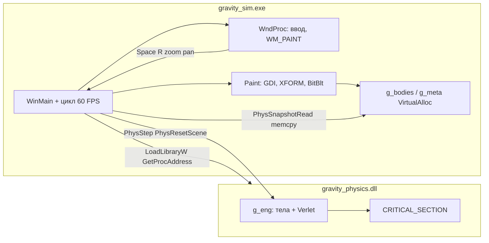

# Моделирование гравитационного взаимодействия тел

Программное средство: **gravity_sim.exe** + **gravity_physics.dll**. Разделение на клиент (окно, ввод, отрисовка) и вычислительное ядро (интегратор, сцена, память тел). Сборка — CMake в каталоге `build/`.

**Порядок чтения исходников:** `common.h` → `physics_dll.c` → `main_win.c`. В файлах — построчные комментарии `//` у ключевых операций.

---

## Схема модулей



**Главное правило:** физика живёт только в DLL; exe **не** обращается к памяти DLL напрямую. Exe держит **свою копию** тел (`g_bodies`, `g_meta`) и обновляет её через `PhysSnapshotRead` после каждого шага. Отрисовка читает **только** эту копию — UI не соревнуется с интегратором; в DLL `Step` и `SnapshotRead` защищены `CRITICAL_SECTION`.

---

## Файлы проекта

| Файл | Роль |
|------|------|
| `common.h` | Типы `Body`, `BodyMeta`, `SimConfig`, `SimStats` и таблица `PhysicsApi` (указатели на экспорт DLL). |
| `physics_dll.c` | Ядро: `VirtualAlloc`, сцена по умолчанию, Velocity Verlet, экспорт `Phys*`. |
| `main_win.c` | Win32-клиент: загрузка DLL, окно, игровой цикл, GDI-рендер, ввод. |
| `CMakeLists.txt` | Сборка `gravity_physics.dll` + `gravity_sim.exe` в один каталог `build/`. |

---

## `common.h` — контракт между exe и DLL

### `Body`

Физическое состояние одного тела в плоскости:

- `x`, `y` — положение в мировых координатах сцены.
- `vx`, `vy`, `ax`, `ay` — скорость и ускорение для **Velocity Verlet**.
- `mass` — масса в условных единицах сцены.
- `radius`, `color` — отрисовка (радиус круга GDI, `COLORREF`).

Структура выровнена на 64 байта (`DECLSPEC_ALIGN(64)`).

### `BodyMeta`

Поле `alive` (1 — тело участвует в силах и рисуется). Остальные поля зарезервированы под расширение метаданных.

### `SimConfig`

Передаётся в `PhysInit` при старте:

- `gravityG`, `softening` — гравитационная постоянная и **смягчение** ε (стабильность при малых расстояниях).
- `dt` — шаг модели, который exe передаёт в `PhysStep` каждый кадр (если нет паузы).
- `paused`, `camX`, `camY`, `camZoom` — **только в exe**; DLL их не читает (камера применяется при рисовании).

### `PhysicsApi`

После `LoadLibraryW("gravity_physics.dll")` exe заполняет структуру через `GetProcAddress`:

| Указатель | Экспорт DLL | Назначение |
|-----------|-------------|------------|
| `Init` | `PhysInit` | Память, критическая секция, параметры G и ε. |
| `Shutdown` | `PhysShutdown` | `VirtualFree`, удаление CS. |
| `ResetScene` | `PhysResetScene` | Пересобрать сцену «ядро + облако». |
| `Step` | `PhysStep` | Один подшаг Verlet на `dt`. |
| `SnapshotRead` | `PhysSnapshotRead` | Копия массивов + статистика. |

Имена экспорта и соглашение вызова **`__cdecl`** совпадают с объявлениями в `physics_dll.c` (`DLL_EXPORT`).

---

## `physics_dll.c` — как устроена физика

### Глобальное состояние `g_eng`

Один статический объект `Engine`:

- Указатели `bodies`, `meta`, `newAx`, `newAy` — **все в одном** регионе `VirtualAlloc`.
- `bodyCount` / `activeBodies` — занятые слоты и число «живых» тел.
- `stepCounter`, `lastStepMs` — для HUD.
- `lock` — `CRITICAL_SECTION`: экспорты, трогающие массивы, входят под `EnterCriticalSection` / `LeaveCriticalSection`.

Интегратор выполняется в потоке, который вызвал `PhysStep` (обычно главный поток exe).

### Выделение памяти (`PhysInit`)

1. `Align64K` округляет размеры сегментов до 64 КБ.
2. Один `VirtualAlloc(..., MEM_RESERVE | MEM_COMMIT, PAGE_READWRITE)` на сумму:
   - `Body[MAX_BODIES]`
   - `BodyMeta[MAX_BODIES]`
   - `double[MAX_BODIES]` для `newAx` и столько же для `newAy`
3. Указатели выставляются смещениями от `base`.

`PhysShutdown` освобождает весь блок одним `VirtualFree`.

### Сцена по умолчанию (`BuildDefaultScene` / `PhysResetScene`)

1. Обнуляет счётчики тел.
2. Ставит **тяжёлое ядро** в `(0,0)` с нулевой скоростью (`coreM = 8000`).
3. Добавляет **280** лёгких тел на кольцах:
   - радиус `r` с плотностью к центру (`sqrt(RandUnit)`),
   - угол случайный,
   - скорость близка к кеплеровской `v ≈ sqrt(G·M_eff/r)` с небольшим разбросом,
   - направление — по касательной (прогрейд).
4. Вызывает `ComputeAccelerations`, чтобы у всех тел были корректные `ax`, `ay` перед первым шагом.

`AddBody` пишет в конец массива, выставляет `meta[i].alive = 1`, увеличивает `activeBodies`.

### Силы (`ComputeAccelerations`)

Для каждой пары `(i, j)`, `i ≠ j`, живые:

\[
\vec{a}_i \mathrel{+}= G \cdot m_j \cdot \frac{\vec{r}_j - \vec{r}_i}{|\vec{r}_{ij}|^3}
\]

В коде:

- `dist2 = dx² + dy² + ε²`, где `ε = softening`,
- `inv = 1/sqrt(dist2)`, множитель `G·m_j·inv³`,
- результат пишется в **`newAx[i]`, `newAy[i]`**, а не сразу в `body.ax` — фаза Verlet не смешивает старое и новое ускорение в одном поле.

Сложность **O(N²)** на шаг; для ~281 тела это укладывается в один поток на типичном ПК.

### Один подшаг Verlet (`VerletSubstep`)

**Velocity Verlet** с фиксированным `dt`:

1. **Позиция** (для всех живых):  
   `r += v·dt + 0.5·a·dt²`
2. **Пересчёт ускорений** из новых позиций: `ComputeAccelerations()`.
3. **Скорость и замена a**:  
   `v += 0.5·(a + a')·dt`, затем `a ← a'`.

### `PhysStep`

Под критической секцией:

- запоминает `curDt`, увеличивает `stepCounter`,
- вызывает `VerletSubstep(dt)`,
- замеряет `lastStepMs` через `QueryPerformanceCounter`.

### `PhysSnapshotRead`

Под той же CS:

- `memcpy` в буферы exe (не больше `maxCount`),
- заполняет `SimStats`: активные/всего тела, счётчик шагов, время шага, объём `virtualMemBytes`.

### `DllMain`

При `DLL_PROCESS_ATTACH` обнуляет `g_eng` до первого `PhysInit`.

---

## `main_win.c` — как устроен клиент

### Старт (`WinMain`)

1. Задаёт `g_cfg` (G, ε, `dt ≈ 0.016`, zoom, не на паузе).
2. `LoadDll` — `LoadLibraryW` + пять `GetProcAddress`; при ошибке — `MessageBox`.
3. `VirtualAlloc` под **локальные** `g_bodies` и `g_meta` (размер `MAX_BODIES`).
4. `PhysInit(&g_cfg)` → `ResetScene()` → первый `SnapshotRead`.
5. Регистрация класса окна `GravitySimWndClass`, `CreateWindowExW`, `ShowWindow`.

### Разделение ответственности: цикл vs `WndProc`

| Где | Что делает |
|-----|------------|
| **Главный `while (run)`** | Очередь сообщений (`PeekMessage`), **`PhysStep`** (если не пауза), **`SnapshotRead`**, `InvalidateRect` + `UpdateWindow`, ограничение FPS (`Sleep`). |
| **`WndProc`** | `WM_PAINT` → `Paint`, клавиши (пауза, сброс), мышь (панорама, зум). **Не** вызывает `PhysStep`. |

Симуляция привязана к кадру; ввод обрабатывается через сообщения Windows.

### Кадр (~60 FPS)

```text
PeekMessage / Dispatch  →  обработка ввода
если !paused: PhysStep(g_cfg.dt)
SnapshotRead → g_bodies, g_meta, g_stats
InvalidateRect + UpdateWindow  →  WM_PAINT  →  Paint()
EMA для g_fps
Sleep до FRAME_SEC (1/60 с)
```

### Отрисовка (`Paint`)

1. `EnsureBuffer` — при изменении размера клиента пересоздаёт `CreateCompatibleDC` + `CreateCompatibleBitmap`.
2. Заливает фон, включает `GM_ADVANCED`, задаёт **`XFORM`**: масштаб `camZoom` и сдвиг так, чтобы мировая точка `(camX, camY)` попадала в центр окна.
3. Для каждого живого тела — `Ellipse` с центром `(floor(x), floor(y))` и радиусом `radius`.
4. Сбрасывает world transform, рисует текст HUD (`TextOutW`).
5. `BitBlt` из памяти DC на экран.

Камера **не** передаётся в DLL: это визуальное преобразование на стороне exe.

### Ввод

- **Пробел** — переключает `g_cfg.paused`.
- **R** — `ResetScene` + snapshot + перерисовка.
- **ПКМ** — `SetCapture`, сдвиг `camX/camY` пропорционально `(dx, dy) / camZoom`.
- **Колёсико** — умножение `camZoom` на 1.12, ограничение [0.15, 8].

`ScreenToWorld` переводит клиентские координаты мыши в мир (зарезервировано для интерактивного добавления тел).

### Завершение

`PhysShutdown`, `VirtualFree` буфера рендера, удаление GDI-буфера, `FreeLibrary`.

---

## Поток данных за один кадр

```text
g_cfg.dt  ──► PhysStep ──► VerletSubstep ──► bodies/meta в DLL обновлены
                    │
                    ▼
            PhysSnapshotRead ──► memcpy ──► g_bodies[], g_meta[]
                    │
                    ▼
              Paint() читает g_bodies, g_meta, g_stats
```

---

## Сборка и запуск

```text
cmake -S . -B build -G "MinGW Makefiles"
cmake --build build
```

(из каталога с `CMakeLists.txt` или `cmake -S mvp -B mvp/build` из корня репозитория.)

Артефакты в `build/`:

- `gravity_sim.exe`
- `gravity_physics.dll` (должна лежать **рядом** с exe)

MSVC / Ninja: тот же `cmake -S . -B build` с нужным генератором.

---

## Управление

| Действие | Эффект |
|----------|--------|
| **Пробел** | Пауза / продолжение |
| **R** | Пересоздать сцену (ядро + 280 звёзд) |
| **ПКМ + drag** | Сдвиг камеры |
| **Колёсико** | Зум |

---

## Материал для отчёта

1. **Постановка:** N тел, закон Ньютона, интегратор Verlet, смягчение ε.
2. **Архитектура:** exe + DLL, `LoadLibraryW` / `GetProcAddress`, `PhysicsApi`.
3. **Память:** `VirtualAlloc` в DLL (единый блок); буфер копии в exe; назначение `PhysSnapshotRead`.
4. **Синхронизация:** `CRITICAL_SECTION` вокруг шага и чтения снимка.
5. **UI:** цикл сообщений Win32, двойная буферизация GDI, камера через `XFORM`.
6. Скриншот окна и фрагмент кода (`VerletSubstep` или цикл `WinMain`).
